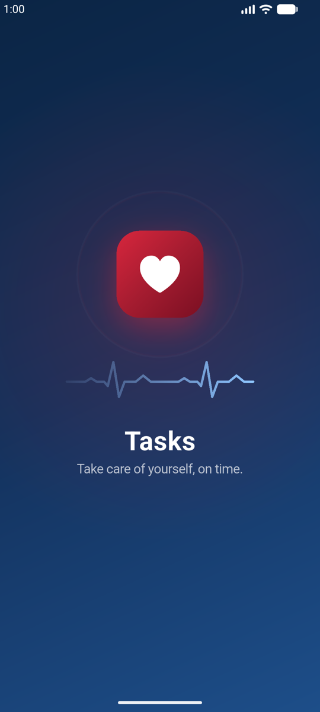
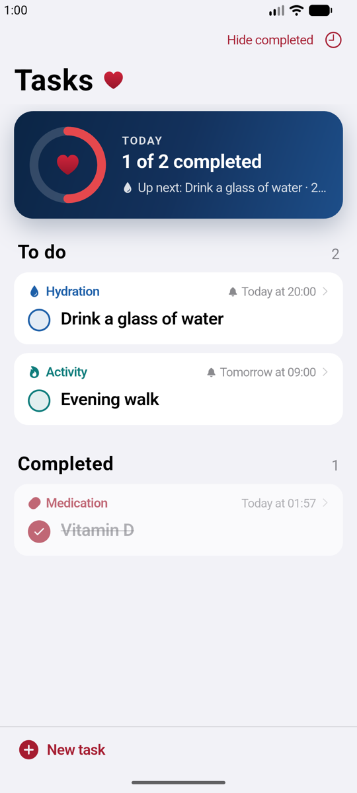
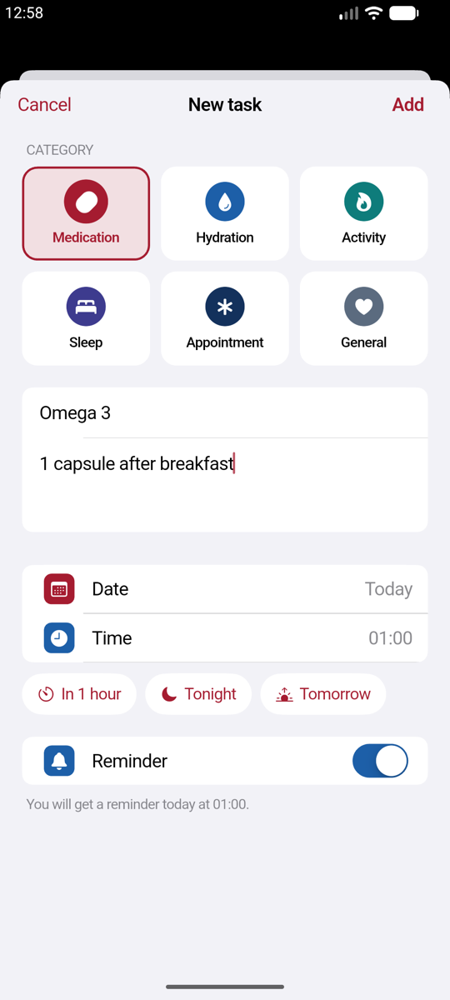
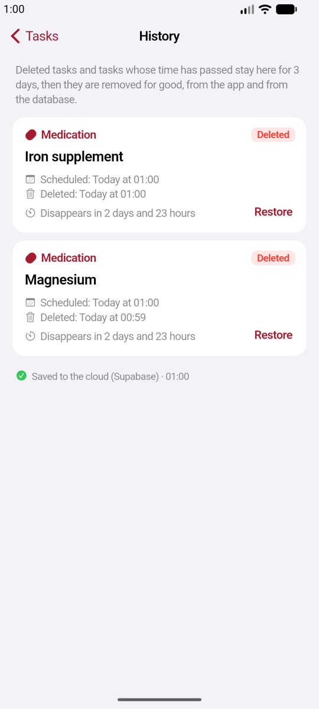

# Tasks ❤️ – health reminders, right on time

**Tasks** is a small, calm app for the healthy habits that are easy to forget:
your pills, a glass of water, a walk, going to bed on time, or a doctor's
appointment. Add a task, pick a time, and your phone reminds you exactly then.

<p align="center">
  
  
  
  
</p>

## 📲 Download (Android)

### [⬇️ Download Tasks.apk](https://github.com/AluxDeveloper/HealthChecker/releases/latest/download/Tasks.apk)

Works on **Android 7.0 or newer**, about 53 MB.

1. Open the link above **on your phone** and download `Tasks.apk`.
2. Tap the downloaded file. Android will ask you to allow installing apps from
   this source (your browser or Files app): tap **Settings → Allow from this
   source**, then go back.
3. Tap **Install**, then **Open**.
4. Allow **notifications** when asked, otherwise you won't get reminders.

> Android may warn that the app is from an unknown developer. That's normal for
> apps installed outside Google Play: the app isn't on the Play Store.
> Tap **More details → Install anyway**.

**Updating:** download the new `Tasks.apk` from the same link and install it
over the old one. Your tasks are kept.

**iPhone:** there is no App Store version yet. You can run it on the iOS
Simulator from the source code (see [Run from source](#-run-from-source)).

## ✨ Features

- **Six health categories**, each with its own colour and icon: Medication,
  Hydration, Activity, Sleep, Appointment and General.
- **Reminders at the exact time.** Each task gets a notification at its date
  and hour, even when the app is closed. You can turn the reminder off per task.
- **Today at a glance.** A card at the top shows how many of today's tasks are
  done, with a progress ring and what's up next.
- **Quick times:** *In 1 hour*, *Tonight* or *Tomorrow* in one tap, or pick any
  date and time.
- **Check off** tasks with a tap, **swipe left** to delete them.
- **History** (🕒 button, top right). Deleted tasks and tasks whose time has
  passed stay there for **3 days**, with a countdown, and deleted ones can be
  **restored**. After 3 days they are removed for good, from the phone and from
  the cloud.
- **Cloud backup without an account.** Tasks are saved in the cloud
  automatically; there is nothing to sign up for.
- **Works offline.** Everything is stored on the phone first and synced when
  the internet is back.
- **Light and dark mode**, following your phone's setting.

## 🔒 Your data

- On first launch the app creates an **anonymous account** for your phone. No
  name, email or phone number is asked or stored.
- Your tasks are stored on your phone and in a cloud database
  ([Supabase](https://supabase.com), PostgreSQL). Database rules (row-level
  security) let each account see **only its own tasks**.
- Deleted and past tasks are erased automatically **3 days** later. The server
  runs this cleanup every hour, even if you never open the app again.
- Uninstalling the app also removes the anonymous account from your phone, so
  the tasks can no longer be recovered. They are erased from the cloud by the
  same 3-day rule.

## 🛠 Run from source

You need [Flutter](https://docs.flutter.dev/get-started/install) (stable
channel, Dart 3.14+). For Android you also need Android Studio with the Android
SDK; for iPhone you need a Mac with Xcode.

```bash
git clone https://github.com/AluxDeveloper/HealthChecker.git
cd HealthChecker
flutter pub get

flutter devices        # list emulators, simulators and phones
flutter run -d android # or: flutter run -d iphone
```

While it runs, press `r` for hot reload, `R` for hot restart and `q` to quit.

Run the tests:

```bash
flutter test
```

### Build the APK

```bash
flutter build apk --release
# → build/app/outputs/flutter-apk/app-release.apk
```

Release builds are signed with the key described in `android/key.properties`
(not in git):

```properties
storePassword=…
keyPassword=…
keyAlias=sarcini
storeFile=/absolute/path/to/your-release-key.jks
```

Without that file, the APK is signed with the local debug key. It installs fine,
but it can't be installed as an update over a version signed with a different
key. Keep the release key and its password backed up: you need the same key for
every future update.

### Use your own Supabase project

The app ships with the URL and *publishable* key of its Supabase project in
[`lib/config/supabase_config.dart`](lib/config/supabase_config.dart). The
publishable key is meant to be public; on its own it gives access to nothing.
To use your own project:

1. Create a project on [supabase.com](https://supabase.com).
2. In **Authentication → Sign In / Providers**, enable **Anonymous sign-ins**.
3. In **SQL Editor**, run [`database/schema.sql`](database/schema.sql). It
   creates the `tasks` table, the security rules, the history view and the
   hourly cleanup job (`pg_cron`). It is safe to run more than once.
4. Put your project URL and publishable key in `lib/config/supabase_config.dart`.

Never put the *secret* key or the database password in the app.

## 🧱 How it's built

| Part | Technology |
| --- | --- |
| App | [Flutter](https://flutter.dev), iOS-style (Cupertino) design |
| Reminders | `flutter_local_notifications` + `timezone` |
| Storage on the phone | `shared_preferences` |
| Cloud | [Supabase](https://supabase.com): PostgreSQL, anonymous auth, row-level security, `pg_cron` |

```
lib/
├── main.dart                     app start, Supabase setup
├── models/task.dart              a task, its history and 3-day expiry rules
├── services/
│   ├── task_store.dart           task list, local saving, sync, cleanup
│   ├── supabase_task_remote.dart cloud sync through the Supabase API
│   └── notification_service.dart scheduled reminders
├── screens/                      intro, task list, editor, history
├── widgets/                      task card, Today summary, beating heart
└── theme/                        colours, categories, date formatting
database/schema.sql               Supabase database: table, rules, cleanup
test/                             widget and logic tests
```

**Syncing:** every change is saved on the phone right away, then sent to
Supabase in the background. When the app starts, comes back to the foreground,
or once a minute while it's open, it merges the phone and the cloud. If the
same task was changed in both places, the most recent change wins.
